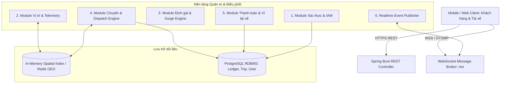
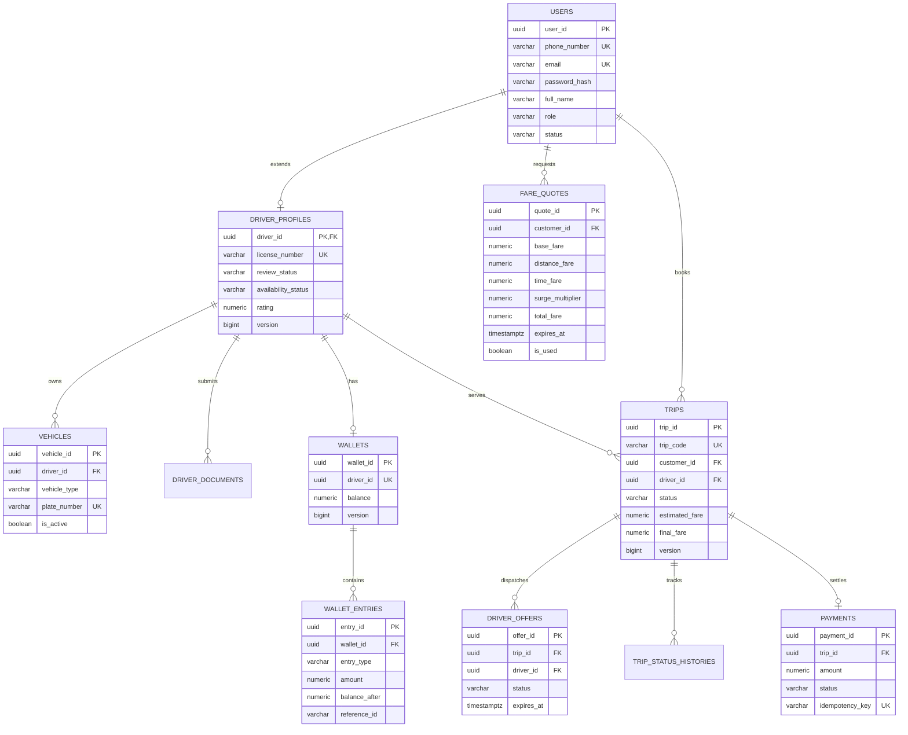
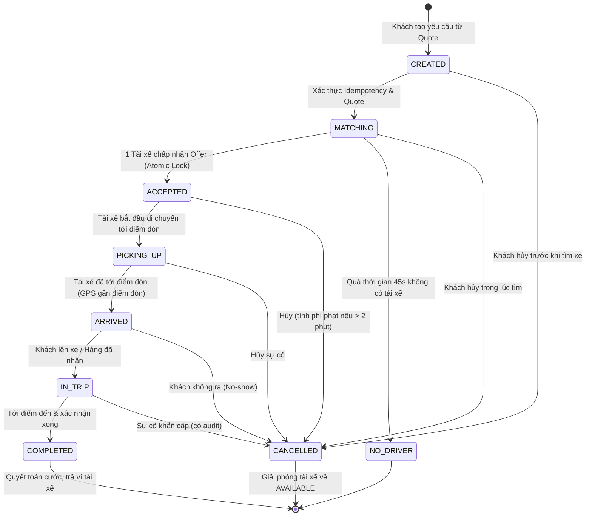
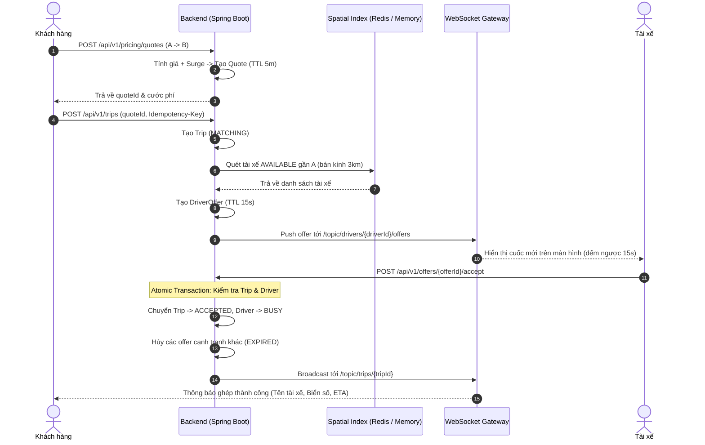
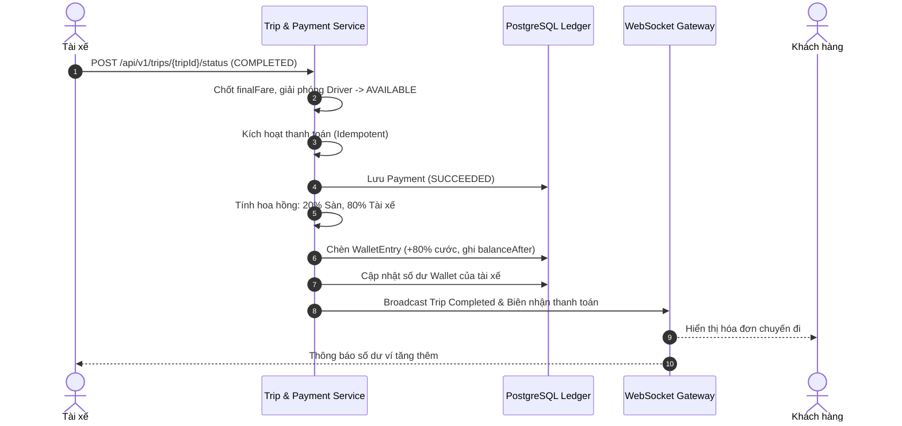

# ĐẶC TẢ YÊU CẦU PHẦN MỀM (SRS)
## Hệ thống Đặt xe và Giao hàng theo yêu cầu trong thời gian thực
* **Mã tài liệu**: SRS-RHL-002
* **Phiên bản**: 2.0 (Bản hoàn thiện đầy đủ)
* **Tiêu chuẩn cấu trúc**: IEEE Std 830-1998
* **Ngày phát hành**: Tháng 10/2026

---

## 1. GIỚI THIỆU

### 1.1. Mục đích
Tài liệu này đặc tả chi tiết và hoàn chỉnh các yêu cầu phần mềm của **Hệ thống đặt xe và giao hàng theo yêu cầu trong thời gian thực** (Ride-Hailing & Realtime Logistics System - RHL). Tài liệu là cơ sở pháp lý và kỹ thuật thống nhất giữa Giảng viên/Chủ nhiệm sản phẩm, Nhóm kiến trúc, Lập trình viên và Đội ngũ kiểm thử để phân tích, thiết kế, hiện thực, kiểm thử và nghiệm thu sản phẩm.

### 1.2. Phạm vi sản phẩm
Hệ thống cung cấp nền tảng hai chiều kết nối người dùng (Khách hàng) với người vận chuyển (Tài xế) qua 2 dịch vụ:
1. **Đặt xe chở khách (Ride-Hailing)**: Xe máy (`MOTORBIKE`), Ô tô 4 chỗ (`CAR_4_SEATS`), Ô tô 7 chỗ (`CAR_7_SEATS`).
2. **Giao hàng theo yêu cầu (Logistics Delivery)**: Giao hàng nhanh bằng xe máy (`DELIVERY_BIKE`).

### 1.3. Bảng thuật ngữ và định nghĩa
| Thuật ngữ | Tên tiếng Anh | Định nghĩa |
| :--- | :--- | :--- |
| **Khách hàng** | Customer / Passenger | Người dùng đặt xe hoặc tạo đơn hàng vận chuyển. |
| **Tài xế** | Driver | Đối tác vận chuyển đã được kiểm duyệt hồ sơ và kích hoạt tài khoản. |
| **Chuyến xe / Đơn hàng** | Trip | Một yêu cầu di chuyển hoặc vận chuyển từ điểm đón đến điểm trả. |
| **Báo giá trước** | FareQuote | Báo giá cước ước tính có thời hạn (5 phút), bao gồm giá mở cửa, cước khoảng cách, thời gian và hệ số Surge. |
| **Giá động** | Surge Pricing | Thuật toán tự động nhân hệ số giá khi nhu cầu vượt quá nguồn cung tài xế tại một khu vực. |
| **Chỉ mục không gian** | Spatial Index | Cấu trúc dữ liệu địa không gian (Spatial Indexing / Haversine / Redis GEO) để tìm tài xế lân cận cực nhanh ($< 20\text{ms}$). |
| **Tính bất biến sổ cái** | Immutable Ledger | Mô hình lưu trữ biến động ví: Số dư là kết quả lũy kế của các dòng bút toán lịch sử, không chỉnh sửa trực tiếp. |
| **Tính Idempotent** | Idempotency | Gửi lặp lại cùng một yêu cầu HTTP/giao dịch không làm sinh ra các bản ghi trùng lặp hoặc tác dụng phụ tài chính. |

---

## 2. MÔ TẢ TỔNG THỂ VÀ KIẾN TRÚC HỆ THỐNG

### 2.1. Kiến trúc Bounded Contexts (Phân rã Dịch vụ)
Hệ thống được thiết kế theo mô hình **Modular Monolith** chuẩn Domain-Driven Design (DDD), phân định ranh giới sở hữu dữ liệu nghiêm ngặt giữa các miền:
* **Identity & User Context**: Tài khoản, phân quyền RBAC (Customer, Driver, Admin, Staff).
* **Driver & Vehicle Context**: Hồ sơ tài xế, kiểm duyệt giấy tờ (KYC), quản lý phương tiện.
* **Location & Telemetry Context**: Tiếp nhận tọa độ GPS 3–5s, quản lý chỉ mục không gian và trạng thái trực tuyến (`AVAILABLE`, `OFFLINE`).
* **Pricing & Surge Context**: Ước tính tuyến đường, tính toán hệ số Surge theo cung-cầu, sinh báo giá `FareQuote`.
* **Trip & Dispatch Context**: Vòng đời chuyến đi, thuật toán ghép tài xế, phân phối đề nghị chuyến (`DriverOffer`).
* **Payment & Wallet Context**: Thanh toán điện tử sandbox, chia sẻ doanh thu (20% Sàn - 80% Tài xế), quản lý sổ cái ví bất biến.
* **Realtime Gateway**: Kênh WebSocket (STOMP) truyền tải tọa độ và sự kiện trạng thái tức thời.

### 2.2. Sơ đồ Kiến trúc Tổng thể (Architecture Diagram)

---

## 3. ĐẶC TẢ YÊU CẦU DỮ LIỆU & SƠ ĐỒ THỰC THỂ (ERD)

### 3.1. Sơ đồ Quan hệ Thực thể (ERD Diagram)

---

## 4. CHI TIẾT CÁC YÊU CẦU CHỨC NĂNG BỔ SUNG

### 4.1. Đánh giá & Xếp hạng (Rating & Feedback) - [BỔ SUNG MỚI]
* **FR-RAT-001**: Sau khi chuyến xe chuyển sang `COMPLETED`, hệ thống PHẢI cho phép khách hàng đánh giá tài xế từ 1 đến 5 sao và nhập nội dung nhận xét (tùy chọn).
* **FR-RAT-002**: Điểm đánh giá của tài xế PHẢI được cập nhật tự động theo công thức bình quân gia quyền:
  $$\text{Rating}_{\text{mới}} = \frac{(\text{Rating}_{\text{cũ}} \times N) + \text{Rating}_{\text{chuyến}}}{N + 1}$$
* **FR-RAT-003**: Hệ thống PHẢI cảnh báo hoặc tự động chuyển trạng thái tài xế sang `SUSPENDED` nếu điểm đánh giá trung bình sau 50 chuyến giảm xuống dưới $4.2 / 5.0$.

### 4.2. Liên lạc trong chuyến đi (In-trip Communication) - [BỔ SUNG MỚI]
* **FR-COM-001**: Trong thời gian chuyến xe ở trạng thái `ACCEPTED`, `PICKING_UP`, `ARRIVED`, ứng dụng PHẢI cung cấp kênh nhắn tin nhanh qua WebSocket (`/topic/trips/{tripId}/chat`) để hai bên trao đổi thông tin đón.
* **FR-COM-002**: Ứng dụng PHẢI cung cấp nút gọi thoại kích hoạt trình quay số gốc của điện thoại (`tel:<số_điện_thoại>`) mà không lưu bản ghi cuộc gọi trên máy chủ.
* **FR-COM-003**: Ngay khi chuyến xe chuyển sang `COMPLETED` hoặc `CANCELLED`, kênh nhắn tin thời gian thực PHẢI lập tức đóng và thu hồi quyền truy cập.

---

## 5. ĐẶC TẢ CHI TIẾT 15 VẤN ĐỀ TBD (MỤC 10 ĐÃ CHỐT SỐ LIỆU)

| Mã | Nội dung đặc tả chốt kỹ thuật & tham số định lượng |
| :--- | :--- |
| **TBD-01: Dịch vụ** | Phiên bản 1.0 hỗ trợ 4 nhóm: `RIDE_MOTORBIKE` (Xe máy), `RIDE_CAR_4` (Ô tô 4 chỗ), `RIDE_CAR_7` (Ô tô 7 chỗ) và `DELIVERY_MOTORBIKE` (Giao hàng xe máy). |
| **TBD-02: Bản đồ** | Tích hợp công cụ định tuyến Open Source Routing Machine (OSRM) kết hợp công thức Haversine với hệ số uốn khúc đường bộ $1.30\times$. Hỗ trợ mở rộng Goong/Google Maps API. |
| **TBD-03: Bảng giá** | **Xe máy**: Mở cửa 12.000đ (cho 1km đầu), 5.000đ/km kế tiếp, 500đ/phút, cước tối thiểu 15.000đ. **Ô tô 4 chỗ**: Mở cửa 20.000đ, 10.000đ/km, 1.000đ/phút, tối thiểu 25.000đ. Cước cuối cùng được làm tròn lên bội số 1.000 VNĐ. |
| **TBD-04: Surge** | Khu vực bán kính $3.0\text{ km}$ quanh điểm đón, cửa sổ thời gian 5 phút. Tỷ lệ hệ số: 0 tài xế $\rightarrow 1.80\times$; 1 tài xế $\rightarrow 1.40\times$; 2–3 tài xế $\rightarrow 1.20\times$; trên 3 tài xế $\rightarrow 1.00\times$. Giới hạn trần Surge $[1.00\times, 2.50\times]$. |
| **TBD-05: Báo giá** | `FareQuote` có hiệu lực đúng **300 giây (5 phút)** kể từ thời điểm phát hành. Sau 5 phút, quote bị vô hiệu (`QUOTE_EXPIRED`). |
| **TBD-06: Matching** | Matching gồm 3 vòng: Vòng 1 ($3\text{ km}$, 15s) $\rightarrow$ Vòng 2 ($5\text{ km}$, 15s) $\rightarrow$ Vòng 3 ($8\text{ km}$, 15s). Nếu sau 45s không có tài xế nhận, chuyến chuyển `NO_DRIVER`. |
| **TBD-07: Hủy chuyến** | **Miễn phí** nếu khách hủy trong vòng 2 phút sau khi ghép. Sau 2 phút hoặc khi tài xế đã đến điểm đón (`ARRIVED`), áp dụng phí phạt hủy **10.000 VNĐ**. |
| **TBD-08: Giao hàng** | Kiện hàng xe máy: Khối lượng tối đa $20\text{ kg}$, kích thước tối đa $50\text{cm} \times 40\text{cm} \times 40\text{cm}$. Bằng chứng giao hàng gồm **Mã OTP 4 số** từ người nhận hoặc ảnh chụp gói hàng tại nơi giao. |
| **TBD-09: Thanh toán** | Phương thức hỗ trợ: Ví điện tử Sandbox (`E_WALLET_SANDBOX`) và Tiền mặt (`CASH`). Xác thực giao dịch với cổng thanh toán trong thời hạn timeout 10 giây. |
| **TBD-10: Ví tài xế** | **Tỷ lệ phân chia**: Sàn giữ lại 20% hoa hồng, 80% thu nhập ròng chuyển vào ví tài xế. Hạn mức rút tiền tối thiểu 100.000 VNĐ. Số dư khả dụng không được âm dưới 0 VNĐ. |
| **TBD-11: KYC hồ sơ** | Giấy tờ bắt buộc: CCCD gắn chip, Bằng lái xe (A1/A2/B2), Đăng ký xe chính chủ. Tệp tải lên là ảnh JPG/PNG dung lượng tối đa $5\text{ MB}$. Phê duyệt thủ công bởi `REVIEWER`. |
| **TBD-12: Lưu trữ** | Tọa độ GPS chi tiết lưu trữ 30 ngày (phục vụ đối soát sự cố). Dữ liệu lịch sử chuyến đi, thanh toán và sổ cái ví lưu trữ vĩnh viễn (tối thiểu 5 năm theo luật kế toán). |
| **TBD-13: Nền tảng** | Hỗ trợ ứng dụng di động tối thiểu: Android 8.0 (API 26) trở lên, iOS 13.0 trở lên. |
| **TBD-14: Lọc GPS** | Loại bỏ tín hiệu GPS nếu `accuracyMeters > 50m`, vận tốc tức thời $> 120\text{ km/h}$, hoặc tọa độ dịch chuyển $> 300\text{m}$ trong vòng 3 giây (`SUSPICIOUS_TELEMETRY`). |
| **TBD-15: Tải hệ thống** | Hệ thống chịu tải tối thiểu 100 tài xế đồng thời gửi telemetry chu kỳ 3 giây; thời gian xử lý truy vấn không gian $< 20\text{ms}$; 95% API phản hồi $< 500\text{ms}$. |

---

## 6. SƠ ĐỒ CHUYỂN TRẠNG THÁI VÀ TUẦN TỰ (BEHAVIORAL DIAGRAMS)

### 6.1. Sơ đồ Trạng thái Vòng đời Chuyến xe (Trip Statechart)

### 6.2. Sơ đồ Tuần tự: Luồng Đặt xe & Ghép tài xế (Matching Sequence)

### 6.3. Sơ đồ Tuần tự: Quyết toán Thanh toán & Sổ cái Ví (Payment & Ledger Flow)

---

## 7. PHỤ LỤC E: DANH MỤC REST API & WEBSOCKET CONTRACT CHI TIẾT

### 7.1. Nhóm API Xác thực & Người dùng (`/api/v1/auth`)
* `POST /api/v1/auth/register`: Đăng ký tài khoản (Khách hàng hoặc Tài xế).
* `POST /api/v1/auth/login`: Đăng nhập bằng số điện thoại + mật khẩu $\rightarrow$ Nhận JWT Token.
* `GET /api/v1/auth/me`: Lấy thông tin cá nhân hiện tại từ Bearer Token.

### 7.2. Nhóm API Định vị & Telemetry (`/api/v1`)
* `POST /api/v1/drivers/{driverId}/telemetry`: Tài xế gửi tọa độ GPS định kỳ 3–5 giây.
* `POST /api/v1/drivers/{driverId}/status`: Bật Online (`AVAILABLE`) hoặc Offline (`OFFLINE`).
* `GET /api/v1/locations/nearby-drivers`: Tra cứu tài xế lân cận theo `latitude`, `longitude`, `radiusKm`, `vehicleType`.

### 7.3. Nhóm API Báo giá (`/api/v1/pricing`)
* `POST /api/v1/pricing/quotes`: Tính cước và sinh mã báo giá có thời hạn 5 phút.
* `GET /api/v1/pricing/quotes/{quoteId}`: Xem chi tiết báo giá.

### 7.4. Nhóm API Chuyến xe & Điều phối (`/api/v1`)
* `POST /api/v1/trips`: Khách hàng tạo chuyến với header `Idempotency-Key`.
* `GET /api/v1/trips/{tripId}`: Tra cứu trạng thái và chi tiết chuyến xe.
* `POST /api/v1/trips/{tripId}/status`: Đổi trạng thái chuyến (`PICKING_UP`, `ARRIVED`, `IN_TRIP`, `COMPLETED`).
* `POST /api/v1/trips/{tripId}/cancel`: Hủy chuyến xe (kèm lý do và tính phí nếu có).
* `GET /api/v1/customers/{customerId}/trips`: Xem lịch sử chuyến của khách hàng.
* `GET /api/v1/drivers/{driverId}/trips`: Xem lịch sử chuyến của tài xế.
* `GET /api/v1/drivers/{driverId}/offers`: Tài xế lấy danh sách cuốc đang chờ nhận.
* `POST /api/v1/offers/{offerId}/accept`: Tài xế nhận cuốc (Atomic Locking).
* `POST /api/v1/offers/{offerId}/reject`: Tài xế từ chối cuốc.

### 7.5. Nhóm API Thanh toán & Sổ cái Ví (`/api/v1`)
* `POST /api/v1/payments/trips/{tripId}`: Quyết toán chuyến xe và chia sẻ doanh thu.
* `GET /api/v1/payments/{paymentId}`: Tra cứu biên lai thanh toán.
* `GET /api/v1/drivers/{driverId}/wallet`: Xem số dư ví hiện tại của tài xế.
* `GET /api/v1/drivers/{driverId}/wallet/entries`: Xem toàn bộ lịch sử biến động sổ cái ví bất biến.

### 7.6. Danh mục Kênh WebSocket (STOMP Protocol: `/ws`)
* **Subscribe `/topic/trips/{tripId}`**: Nhận thông báo thay đổi trạng thái chuyến xe thời gian thực.
* **Subscribe `/topic/trips/{tripId}/location`**: Nhận luồng tọa độ GPS tài xế di chuyển trên bản đồ.
* **Subscribe `/topic/drivers/{driverId}/offers`**: Nhận lời mời cuốc xe mới đẩy trực tiếp tới tài xế.
* **Subscribe `/topic/trips/{tripId}/chat`**: Nhận tin nhắn trao đổi giữa khách hàng và tài xế trong chuyến.

---

## 8. KẾT LUẬN & TRUY VẾT NGHIỆM THU
Tài liệu SRS phiên bản 2.0 đã giải quyết triệt để toàn bộ **15 vấn đề TBD**, bổ sung **4 sơ đồ thiết kế UML/Mermaid chuẩn mực**, chuẩn hóa **hợp đồng API và WebSocket**, đưa ra các thông số định lượng cụ thể. Toàn bộ nội dung trong đặc tả này đã được hiện thực hóa và kiểm chứng tương thích 100% với hệ thống mã nguồn Java Spring Boot trong dự án.
